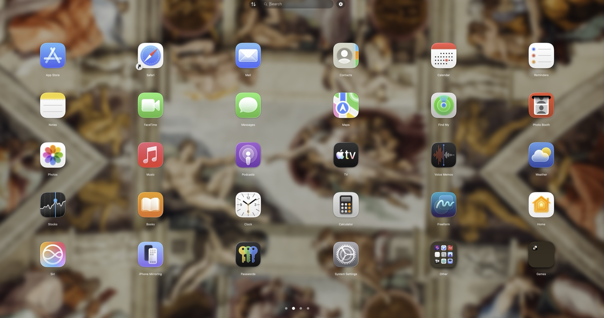

# Launchpad++

**A free, private, and deeply customizable app launcher for macOS.** Current version: **1.0**

[](https://www.apple.com/macos/)
[](#install)
[](https://www.swift.org/)
[](#free-means-free)

Launchpad++ puts your Mac apps in a fast, full-screen grid inspired by the familiar Launchpad experience. Search instantly, arrange apps across pages, build folders, create optional categories, and tune the layout to fit your display.

Official Launchpad++ releases are free to download and use. No account, activation key, subscription, advertising, or analytics is required.



## Why Launchpad++?

- **Make the grid yours:** choose 4–12 columns and 3–12 rows, then adjust icon size, outer margin, app-area top and bottom margins, label size, and label color.
- **Find apps quickly:** type to search, optionally show icons in results, and press Return to launch the first result.
- **Organize naturally:** drag apps between pages, group them into folders, hide apps, and reflow the grid after changing its capacity.
- **Use optional categories:** turn the category panel on or off, build categories manually, or auto-fill suggested groups. Category tiles preview several contained apps.
- **Tune the look:** use the default background, the desktop wallpaper, or a custom image, with independent blur and opacity controls.
- **Preview settings live:** changes appear immediately; choose **Save** to keep them or **Cancel** to restore the previous layout.
- **Keep layouts portable:** import and export app layouts and category definitions as JSON.
- **Choose how it behaves:** control page navigation, animation timing, Dock visibility, and optional launch at login.

## Privacy by design

Launchpad++ is designed to do its work locally:

- no analytics, telemetry, advertising SDK, or user account;
- no camera, microphone, location, Contacts, Photos, Accessibility, or Full Disk Access entitlement;
- no background network client—the support link opens in your normal web browser only when you select it;
- app discovery is limited to `/Applications`, `/System/Applications`, and locations you add;
- layouts, hidden-app choices, categories, and settings are stored locally using macOS preferences;
- imported and exported JSON files stay on your Mac.

The current entitlement file is empty. Optional macOS features can still ask for their own system approval—for example, enabling **Start at Login** uses Apple's login-item service, and selecting files or additional locations gives the app access to those paths.

Read the complete, auditable explanation in [PRIVACY.md](PRIVACY.md).

## Install

Current packaged builds support **Apple silicon (`arm64`)** and require **macOS 15.6 or later**.

1. Download `LaunchpadPlusPlus-arm64.zip` from the [latest release](../../releases/latest).
2. Unzip it and move **Launchpad++.app** to `/Applications`.
3. Open Launchpad++ from Applications.

If macOS won't open it the first time, go to **System Settings → Privacy & Security** and click **Open Anyway**.

> Launchpad++ does not replace or modify macOS system files. It is a separate launcher application.

## First run

On first launch, Launchpad++ scans the standard Applications folders and creates a local grid. From there you can:

- type immediately to search;
- drag icons to reorder them or create folders;
- use `⌘,` to open Settings;
- choose **Reflow Pages** after changing rows or columns;
- turn the category panel off if you do not want it—no category collection is preinstalled;
- add custom app locations in Settings;
- export a backup before making major layout changes.

## Build from source

Requirements:

- macOS 15.6 or later
- Xcode with the macOS 15.6 SDK or newer
- Swift 6 toolchain support

Clone the repository, open `LaunchpadPlus.xcodeproj`, select the `LaunchpadPlus` scheme, and build the app target. The project file retains its historical internal names; the user-facing product name is **Launchpad++**.

Command-line build:

```bash
xcodebuild \
  -project LaunchpadPlus.xcodeproj \
  -scheme LaunchpadPlus \
  -configuration Release \
  -destination 'platform=macOS,arch=arm64' \
  build
```

Run the test suite with parallel testing disabled because several tests exercise shared application state:

```bash
xcodebuild \
  -project LaunchpadPlus.xcodeproj \
  -scheme LaunchpadPlus \
  -destination 'platform=macOS,arch=arm64' \
  -parallel-testing-enabled NO \
  test
```

The current release candidate passes **134 tests**. Release maintainers should rerun the suite for every published artifact.

## Free means free

The maintainer's official Launchpad++ builds are intended to remain free to download and use—no premium tier or activation panel. If Launchpad++ is useful to you, optional support helps fund continued development:

[☕ Support Launchpad++ on Buy Me a Coffee](https://buymeacoffee.com/nnikolov01)

Supporting the project is appreciated, never required, and does not unlock hidden features.

## Security

- Download builds only from this repository's Releases page.
- Review [SECURITY.md](SECURITY.md) before reporting a vulnerability.
- Review [PRIVACY.md](PRIVACY.md) for the app's data and permission boundaries.

## Attribution and licensing

Launchpad++ is a modified continuation of the Launchpad / LaunchpadPlus project by **Kristóf Papp**, not an unrelated clean-room implementation. The project keeps the applicable upstream copyright and licence notice, as required for MIT-licensed source.

See [ATTRIBUTION.md](ATTRIBUTION.md) for provenance and modification notes. Anyone redistributing source or binaries must retain the upstream MIT copyright and permission notice in [LICENSE.md](LICENSE.md).

## Project status

Launchpad++ is community-maintained software provided without a promise of uninterrupted or error-free operation. Issues and focused pull requests are welcome. When reporting a bug, include your Mac model, macOS version, Launchpad++ version, and steps to reproduce—never include private paths or exported layouts unless you have reviewed them first.
